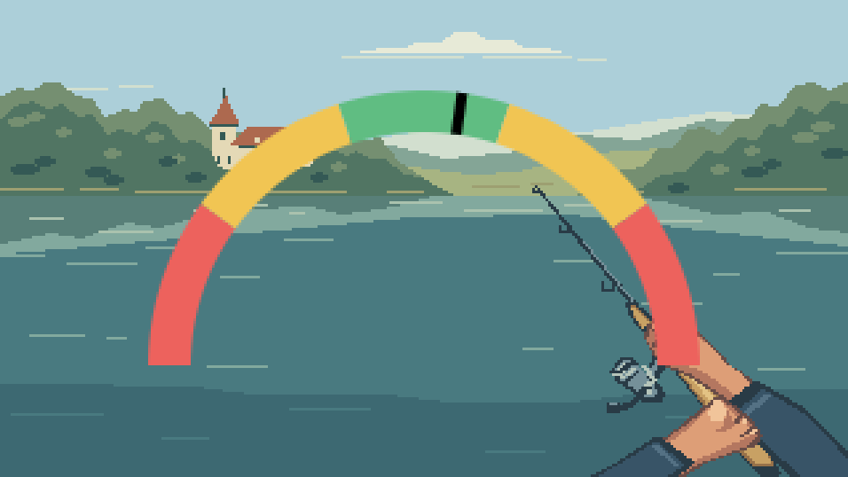
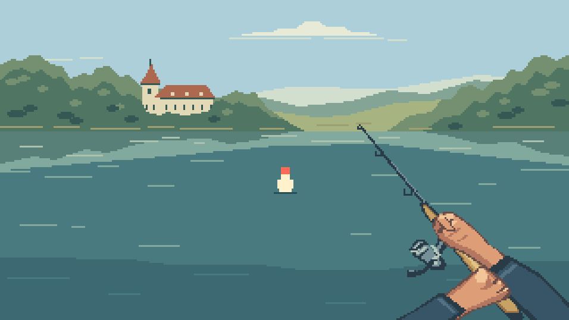

# Frontend

ByteBait's frontend is a standalone Blazor WebAssembly app targeting .NET 10.
The project is in `Frontend/ByteBait.Client/` and is included in the root solution.

## Requirements

- .NET 10 SDK. A .NET runtime alone cannot build the project.
- A current browser, such as Chrome or Edge.
- Node.js 22 for JavaScript syntax checks and module tests; no npm packages are required.

## Run locally

Run these commands from the repository root:

```powershell
dotnet restore ByteBait.slnx
dotnet run --project Frontend/ByteBait.Client --launch-profile http
```

Open <http://localhost:5173>. The development server does not open a browser automatically.
Local development uses HTTP on localhost, so no development certificate is needed.
Stop the server with `Ctrl+C`.

The foundation page at `/` displays **ByteBait** and **Frontend foundation is ready.**
Choose **Open game** to navigate to `/game`.

`/game` needs a signed-in player (#77), and the standalone client has no API to sign in
against, so it shows **Couldn't check your login**. To play, run the API with a local PostgreSQL
database and the `https` profile, open <https://localhost:7172>, choose **Create account**
and then **Open game**. The [browser tests](#cast-saving-tests-in-chrome) still use the
standalone client: they answer `GET /api/account/me` themselves. See the
[backend setup](../Backend/README.md).

## Accounts

The bar at the top shows who is signed in, with **Sign in** and **Create account** or
**Sign out**. `/login` and `/register` use the account endpoints in the
[API contract](../docs/api-contract.md). A page with `[Authorize]` sends a signed-out
player to `/login` and back afterwards. `/admin` is the admin panel, where fish species are
created, edited and deleted (#27). It needs the `admin` role; see the
[backend setup](../Backend/README.md) for how to give it. A warning lists the lanes that are
missing a rarity at a depth. The login cookie is `HttpOnly`,
so the client asks `GET /api/account/me` who is signed in (`PlayerAuthenticationStateProvider`).

Only a real answer is kept: `200` (signed in) or `401` (signed out). If the check gets no answer, for example a
timeout or a `503` while the API or the database is waking up, a page that needs login shows
**Couldn't check your login** with **Try again** instead of sending the player to `/login`. The player may still be
signed in, so **Try again** asks once more and opens the same page, also the same level.

Every `401` from the API means the login cookie has expired (`LoginExpiredHandler`). The page then stops showing
the player as signed in. If that happens during a cast, `/game` sends the player to `/login` and back to the same
level afterwards. Leaving the game page releases USB, so choose **Connect USB** again after signing in.

**Sign out** only signs the player out on the page once the API has confirmed it. If the API doesn't answer, the
bar shows **Couldn't confirm that you're signed out. Try again.**, so the next person on a shared PC isn't left
signed in as them.

## Cookie notice

On the first visit every page shows a notice that ByteBait only uses necessary cookies, with **Got it** and a link
to the cookie policy on `/cookies`. Every page also links to the policy at the bottom. **Got it** is remembered in
local storage (`bytebait_cookie_notice`), so the notice stays away until the policy changes. Raise
`CookieBanner.PolicyVersion` when a cookie is added or changed, and update the table on `/cookies`. Login and
saving casts work without clicking the notice (S2.15).

## Casting meter

Practice (`/game`) and both Nordborg levels (`/game?levelId=1` and `/game?levelId=2`) show
the casting meter over Nordborg Sø, with the castle on the far bank and the rod in the player's hands.
Other levels use the plain meter background. The scene is visible before sign-in or USB connection.
The client draws the lake and rod once per visit and reuses that image behind both the needle and the float.

| Before the cast | Waiting for a bite |
| --- | --- |
|  |  |

The black needle starts at rest on the left. Choose **Start meter** to sweep across the arc
in two seconds and back in two more. Each pass through the green zone lasts 400 ms.
**Pause meter** freezes the needle. **Resume meter** continues in the same direction.
The meter waits for manual start even with reduced motion enabled. Switching tabs freezes
a running needle until the game is visible again. Returning to the game after leaving the
page opens a fresh meter.

`Pages/Game.razor` reads the level from the link. Its `FishingSession` component owns
the keyboard-accessible controls and status for that visit. On first render the component
creates a game with `wwwroot/js/fishing-game.js`. The game hands the same canvas to
`timing-meter.js` during casting and to `float-run.js` while waiting for a fish. JavaScript uses differences
between visible animation-frame timestamps to move and draw the needle. Removing the canvas
cancels its frame and releases its listener and observer.

The 320 × 180 drawing buffer scales with the page. The arc is centered at (160, 138),
with a radius of 96 pixels and a 16-pixel stroke. Reading from left to right, the five equal
segments are red, yellow, green, yellow and red. The same zone boundaries drive the painting
and `getZone(position)`, which takes a number from 0 to 1 and returns the lowercase zone name.
At a boundary the zone on the right applies, so 0.4 is green, 0.6 is yellow and 1 is red.

### Reading the needle history

`readMeterAt(canvas, targetMs)` returns `{ position, zone, frameTimestampMs }` for the last
frame drawn at or before `targetMs`. Both timestamps are milliseconds on the page's
`performance.now()` clock. Each frame is recorded immediately after its needle is drawn.
For example, if a green frame is drawn at 1180 ms and a yellow frame at 1220 ms, a lookup
for 1210 ms returns green with `frameTimestampMs` equal to 1180.

The target can be up to and including 500 ms before the lookup. During a visible rendering
stall, the last frame still describes the needle on screen, even when that frame is older
than 500 ms. Each canvas starts a fresh history with its first active frame after start,
resume or return to a visible tab. Pausing, hiding the tab or leaving the page clears its
history. An invalid target or a time outside the available history returns `null`.

## USB controller

Open `/game` in desktop Chrome or Edge on localhost or HTTPS. Close Arduino Serial Monitor
if it is using the controller. Choose **Connect USB** and select the MKR WiFi 1010 in
the browser's port picker. Once **USB connected.** appears, one valid `THROW:72` line
adds one to **Throws received**. When the game accepts a new throw, it also shows its strength. A cast can arrive
while the meter is paused. A new successful connection starts at zero.

`usb-controller.js` reads the port at 115200 baud, 8N1. Each connection has a separate
32-byte ASCII line buffer. LF completes a message and CR is ignored. The reader accepts
`HELLO:USB:1`, `PONG:<counter>`, `THROW:<strength>` (integer 0–100) and `HOOK`. It can receive
a cast immediately after opening the port because the controller may already have sent
its startup greeting. Protocol errors are reported to the board at most once per second.
JavaScript timestamps the chunk that completes each throw with `performance.now()`.
Blazor counts every valid throw, including those without a score. During an active cast, additional throws only increase the counter.

Each complete `HOOK` line raises the Blazor component's optional `HookReceived` callback
once, including before the first latency reply. Its argument is the browser's
`performance.now()` timestamp in milliseconds for the read that delivered the line feed.
Hooks completed in the same read share that timestamp. The callback passes it through
without subtracting the throw's 250 ms measurement window or the estimated USB latency.

### USB latency

The game sends a numbered `PING` when the port opens and every five seconds thereafter,
including while the meter is paused. JavaScript timestamps the actual write and the
received `PONG` with `performance.now()`. A matching echo gives the **Round-trip time**.
Half that value is the **Estimated one-way time**, assuming similar delays in both
directions. The page keeps the latest sample at full precision and displays milliseconds
to one decimal place. For example, an echo received 20 ms after sending gives a 10 ms estimate.

Before the first match the page shows **Measuring USB latency…**. After 15 seconds
without a matching reply, measured from opening or from the last accepted reply, the game
releases the port and clears the sample. Choose **Connect USB** to start a fresh measurement.
Unknown, duplicate and superseded echoes do not extend the deadline.

Choose **Disconnect USB** to release the port. Removing the cable or leaving the game also
ends the session. After reconnecting, an incomplete line from the previous session is
discarded. See the [controller protocol](../docs/protocol.md) for the message format.

### Live zone on the Oplà LEDs

All five LEDs follow the zone under the moving needle. Connecting during green sends
`LED:GREEN` immediately, even before the first latency reply. Across a full outward
sweep the board receives red, yellow, green, yellow and red. Frames in the same zone
share one command. A scored throw stops the meter and queues `LED:OFF` immediately.
This replaces any color waiting for the writer. A write already handed to the port can finish.

`subscribeZone(canvas, listener)` reports the current zone immediately and each change
after drawing. It reports `off` while the meter is ready, paused or hidden. Resume or
return to the running game to light the LEDs on the first visible frame. The USB session
writes these updates on the same writer as its probes. If a write stalls, the newest
waiting color replaces earlier ones. Disconnecting or leaving the page removes the
listener and attempts a final `LED:OFF` before releasing the port.

### Cast zone at the trigger

The controller reports strength after its 250 ms peak-measurement window. Since the USB
message carries no trigger timestamp, the browser estimates it by subtracting 250 ms and
the current connection's latest one-way latency from the receipt time. It looks up the last
frame drawn on the game canvas at or before that instant. A throw received at 1260 ms
with a 20 ms round trip targets 1000 ms. If the last frame visible at 1000 ms was green
and the needle is yellow on receipt, the page shows **Last cast zone: Green** and replaces
the meter with a still float. The result keeps the estimated trigger time (1000 ms in this example)
as `castAt` in ISO 8601 UTC, using the page's `performance.timeOrigin`.

Before the connection's first matching echo, a throw shows **Cast not scored. Waiting
for USB latency.** A paused or hidden meter, a trigger before the first active frame, or
a target older than 500 ms gives **Cast not scored. No meter history for this throw.**
Either message replaces the previous zone. A new connection clears the last throw.

### Save a scored cast

For each scored throw, Blazor first fetches `GET /api/account/antiforgery` on the
game's origin. It sends the returned token in `X-XSRF-TOKEN` on one `POST /api/casts`.
The signed-in player's cookies accompany both calls. The JSON carries the
historical `zone`, `strength` divided by 100, and the estimated trigger time `castAt`
in UTC. For example, `THROW:72` in green sends a strength of `0.72`, while the raw
strength on screen stays at 72. Throws without a score only update the local counter.

**Saving cast…** appears below the zone while the request is pending. **Cast saved.**
means the API returned `201 Created` after writing to PostgreSQL. Both requests
share one ten-second deadline. A failed token fetch shows **Cast was not sent.**
A `401` shows **Sign in to save your cast.** and sends the player to `/login` (see [Accounts](#accounts)). A rejected POST (`400`) shows
**Cast rejected by the server.** An unexpected or lost POST response, including
a timeout, shows **Cast save could not be confirmed.** The insert may already have
succeeded, so the client never repeats the POST. After a failure the meter starts a fresh sweep
from red. A disconnected session or a previous visit cannot apply a late receipt.
See the [Sprint 1 API contract](../docs/api-contract.md#gem-et-kast).

### Hooking a fish on /game

On a scored throw the arc disappears and the float rests on the surface while the token and cast requests are pending.
In practice and on levels 1 and 2, the castle, hands and rod stay in place through both nibbles,
the bite and the return to the meter. Other levels show the float on the standard water background.
USB latency probes continue during the requests.
In practice mode a 201 starts the fishing clock when the page is visible. For a level cast,
the receipt must also contain the fish for that level. Only one cast owns the canvas.
During each 800 ms nibble only the red tip is visible. A pull then shows **Fish scared away**.
When the tip disappears and two rings appear, a pull shows **Fish hooked**. Below are the
times on the visible fishing clock. Each new phase starts at its listed time.

| Time from start | Float | Result of a USB pull |
| --- | --- | --- |
| 0 ms | Resting on the surface | Keep waiting |
| 1,500 ms | First nibble | Fish scared away |
| 2,300 ms | Resting on the surface | Keep waiting |
| 3,200 ms | Second nibble | Fish scared away |
| 4,000 ms | Resting on the surface | Keep waiting |
| 4,900 ms | Underwater, two rings visible | Fish hooked |
| 6,400 ms | Bite ends | Fish escaped if still unresolved |

Open `/game` for **Practice mode**. It omits `levelId` from the POST and allows the full
hook sequence for a signed-in player. Open `/game?levelId=<id>` with a positive ID
from the game database for a level cast. The client includes that `levelId` alongside
`zone`, `strength` and `castAt`. Changing level or switching to practice ends the current
attempt and releases USB. Use **Connect USB** on the new screen.

For a level cast the client checks the 201 body for the requested level, a positive cast
`id` and the server's `fish`. A hook during the bite passes `{ castId, levelId, fish }`
to `FishingSession.OnGameState` once. The fish carries `speciesId`, `name`, `rarity`,
`weightKg` and `lengthCm`. Its details stay hidden for the fight. With a missing fish,
a mismatched level or an unreadable receipt, the page shows **Cast saved, but no fish
is available for this cast.** and restarts the meter. Practice hooks carry no fish.
A successful hook uses the existing receipt. Reporting a fight result to `/api/catches` belongs to #21.

The level cast uses the API from [backend PR #101](https://github.com/Mercantec-GHC/H3-Online-ByteBait/pull/101).
The server uses the cast's depth when selecting a species and falls back to the lane's
other species if necessary. A lane with no species returns a null fish.

After either loss the meter starts from red with an empty previous-cast history. The
result stays visible until the next scored cast. After a successful hook the water stays
still until **Cast again**. The LEDs stay off throughout saving, nibbles and the bite.

Switching tabs pauses the float. On return, the remaining cadence must fit within the
proposed firmware's 60-second motion window, measured from receipt of the original
throw. Otherwise the game shows **Controller motion window expired. Cast again.**
and restarts the meter. If the port disconnects or its 15-second heartbeat expires,
the game discards the active cast. Choose **Connect USB** to reconnect.

## Build and test

Run from the repository root:

```powershell
dotnet restore ByteBait.slnx
dotnet build ByteBait.slnx --configuration Release --no-restore
$scripts = Get-ChildItem Frontend/ByteBait.Client/wwwroot/js/*.js, Frontend/ByteBait.Client.Tests/browser/float-preview.js
foreach ($script in $scripts) {
    node --check $script.FullName
    if ($LASTEXITCODE) { throw "Invalid JavaScript in $($script.Name)" }
}
node --test "Frontend/ByteBait.Client.Tests/*.test.mjs"
git diff --check
```

The Node suite checks zone boundaries and arc geometry, needle positions at 30 and 60 fps,
both turning points, pause and resume on the return sweep, tab visibility, rapid commands,
navigation cleanup and initialization failures. History tests cover the draw time of a
zone change, the inclusive 500 ms limit, rendering stalls and separate canvas histories.
The USB tests supply simulated serial ports. They check split and batched messages,
error replies, exclusive reader and writer locks, unplugging, and cleanup when port
selection or opening finishes after navigation. Controlled-clock tests check probe timing,
matched and stale echoes, queued writes, the 15-second deadline and manual reconnection.
Cast integration tests feed serial bytes into the running meter and check the historical
zone, UTC trigger time, missing history, fractional latency at the 500 ms limit, and the
order of throws and replies in a single delivery.
LED tests check both sweeps, pause, tab visibility, unplugging, navigation and reconnecting
mid-sweep. A simulated slow port checks that old colors are dropped and casts still arrive.

The [issue #7 frontend README](https://github.com/Mercantec-GHC/H3-Online-ByteBait/blob/9387ca0ba1fd2f6276a42b8521d9fd6aa212f69a/Frontend/README.md) documents the original square demo and its test results.

## Browser checks

1. Start the API with the `https` profile (`dotnet run --project Backend/ByteBait.Api --launch-profile https`,
   see the [backend setup](../Backend/README.md)) and open <https://localhost:7172>. Choose **Create account**,
   then **Open game**. The standalone client on port 5173 can't sign in, so it never reaches **Connect USB**.
2. Set the viewport to 1280 CSS pixels wide, then 390. At each width check that the complete
   upper semicircle fits inside the frame, with green at the top, red at both ends and no
   horizontal page scrolling. The black needle should be still at the left endpoint.
3. Use the keyboard to activate **Start meter**, then **Pause meter** on the return sweep.
   Check that the needle stays still and **Resume meter** continues toward the left.
   Switch tabs while running and while paused. Only the running meter should resume.
4. Choose **Back to home** while running, return via **Open game**, and reload. Confirm
   a fresh, still meter on each visit. Enable reduced motion in the browser, reload and
   check that manual start and pause still work. Check the browser console for errors.
5. To check the error state, block the served `fishing-game.js` request in
   DevTools and hard-reload. Check the English error message, then remove the blocking
   rule and reload to confirm recovery.
6. For a physical USB check, connect an Oplà running the standard USB sketch, select it
   with **Connect USB**. After the first reply, check that both latency values are shown,
   including when the meter is paused. Start the meter, let it run for a full sweep, and
   cast near the middle of green. Check for **Last cast zone: Green**, a strength from
   0 to 100, and one received throw. The needle gives way to the waiting float.
   Unplug, reconnect and confirm the counter starts at zero and the previous assessment clears.
7. For the physical LED check, open the API-hosted game at <https://localhost:7172/game>
   in the signed-in browser. Start the meter and connect USB during a sweep. Watch all
   five LEDs together as the needle crosses red, yellow and green in both directions.
   Pause, resume, switch to another tab, then return. The LEDs should go dark while
   paused or hidden and follow the needle again when running and visible. Make one cast
   and check that the count increases by one and all five LEDs go dark. With hook-enabled
   firmware, pull during a dip, during the rings, and let one bite pass in separate casts.
   For the level check, use `/game?levelId=<id>` on the API host with fish available on that
   level's lane. Check the three outcomes above and look for red when the next sweep begins.

## Local float preview

Run this from the repository root on Windows with Python installed:

```powershell
py -m http.server 5174 --bind 127.0.0.1 --directory Frontend
```

Open the [local float preview](http://127.0.0.1:5174/ByteBait.Client.Tests/browser/float-preview.html) in Chrome.
Its pixel-art background looks across Nordborg Sø towards the castle, using the
[view from Nordborg Søpark](https://www.visitsonderjylland.dk/turist/planlaeg-din-ferie/nordborg-soepark-gdk1148124) as a reference.
Two hands hold a cork-handled spinning rod to the right of the float throughout the cast.
This test page runs the game's hook rules and canvas renderer with simulated input. It runs independently
of the Blazor host, API and USB controller. Stop the local server with Ctrl+C.

1. Choose **Simulate cast**. The red tip and pale body float above the water. At each of two nibbles only the tip remains visible, then the body rises again.
2. Choose **Simulate hook** when the float disappears and two rings appear. Expect **Fish hooked**. A pull during a nibble shows **Fish scared away**. Letting the rings disappear shows **Fish escaped**.
3. **Simulate cast** starts a fresh attempt at any time. Switching tabs pauses the attempt until you return. Try at a narrow and a wide window size, using Tab and Enter to operate the controls.

With the preview server running and the Playwright dependency installed as described under
[Cast saving tests in Chrome](#cast-saving-tests-in-chrome), run:

```powershell
node --test Frontend/ByteBait.Client.Tests/browser/float-preview.test.cjs
```

The tests read actual canvas pixels in Chrome. A controlled clock places frames and keyboard
input just before and at the edges of the bite, including a late pull between animation frames.

## Backend tests

`dotnet test ByteBait.slnx --configuration Release --no-build` runs the .NET tests.
Database tests require a dedicated PostgreSQL test database through `ConnectionStrings__Default`.
Leave it unset to skip those tests locally. Never point automated tests at a shared Neon database.

## Cast saving tests in Chrome

For mocked HTTP responses, start the standalone client on port 5173 (or set
`BYTEBAIT_TEST_PORT` to its local HTTP port).
From the repository root, run the optional browser
suite with Chrome installed. Its Playwright dependency is local to the browser tests.

```powershell
npm install --prefix Frontend/ByteBait.Client.Tests/browser --no-save --package-lock=false playwright-core@1.63.0
node --test Frontend/ByteBait.Client.Tests/browser/cast-saving.test.cjs
```

The tests check the meter backdrop in practice and on levels 1, 2 and 3, including
navigation between levels. Canvas pixels show where the needle stops and resumes.
During a cast the tests also read the float, rings and scenery from the canvas, including
while the HTTP response is pending and when the meter returns after a loss or **Cast again**.
Cast tests drive the real game with simulated serial messages and controlled HTTP
responses. Three consecutive level casts exercise a pull during the second nibble, a
missed bite followed by a late pull, and a successful hook. The test compares all LED
writes and checks which fish reaches Blazor. A separate test splits a `HOOK` line
across a simulated unplug during the bite and a manual reconnection. The suite also
covers stalled writes, tab switches, timeouts and late receipts across navigation.
To run the real API cases, point the API at a dedicated local PostgreSQL test database
with the current migrations and seed data. Start its HTTPS profile and set
`BYTEBAIT_TEST_CAST_DATABASE=1` and `BYTEBAIT_TEST_LEVEL_ID=1` in the test process.
Run the browser suite above. It opens the API-hosted game at `https://localhost:7172`
(override the port with `BYTEBAIT_TEST_PORT`). The tests create temporary players via
`/api/account/register`. Registration signs the player in using the same cookie jar as
the game. Chrome checks anonymous and stale-token rejections, one POST per scored
throw, and the cast ID and fish that reach Blazor after a real 201. The tests print
the cast IDs for comparison with PostgreSQL. USB input is simulated.

For a physical check, open the API-hosted game in Chrome and filter the Network tab
to `/api/casts`. Connect the Oplà, wait for the latency measurement and start the meter.
Note the counter and make one cast. Check for one increment, one POST returning 201,
and **Cast saved.** Use the response ID to check the new row and compare its zone,
normalized strength and UTC cast time with the request.
