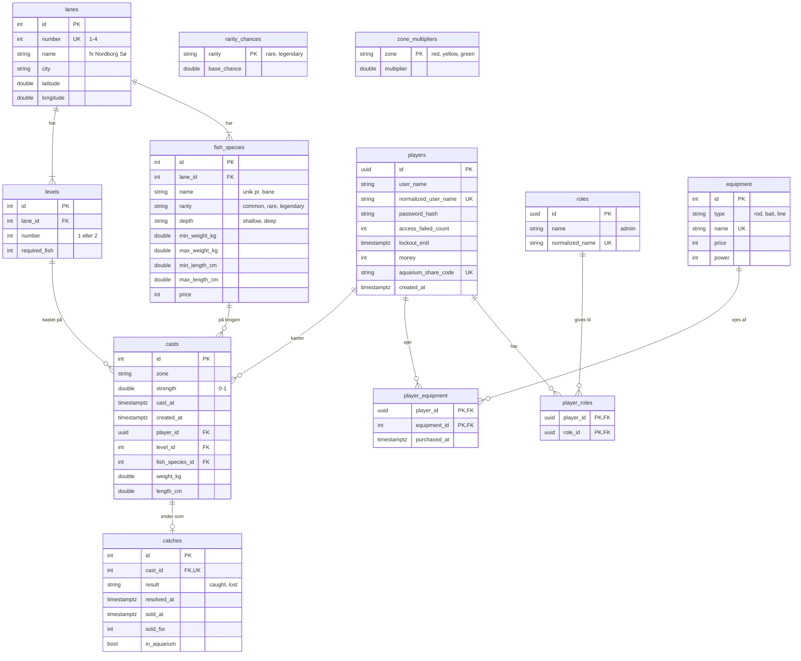

# Datamodel

Datamodellen for ByteBait (S1.11). Tabellerne ligger i Neon og oprettes af migrations i `Backend/ByteBait.Data`. Navne er på engelsk og i snake_case, og enums gemmes som tekst med små bogstaver, fx `rarity = 'rare'`.

Ejer: Frederik (@Juuul999). Ændringer i modellen laves med en ny migration, se [Backend/README.md](../Backend/README.md#migrations).

## ER-diagram

`rarity_chances` og `zone_multipliers` har ingen relationer. De er indstillinger, som spillogikken læser, når fisken vælges.

## Tabellerne

| Tabel | Indhold |
|-------|---------|
| `lanes` | De fire baner. Koordinaterne bruges til vejret fra Open-Meteo |
| `levels` | To niveauer pr. bane med antal fisk, der skal fanges |
| `fish_species` | Fiskearter pr. bane med sjældenhed, dybde, størrelse og pris. Samme art kan findes på flere baner. PostgreSQL's systemkolonne `xmin` bruges som version (`FishSpecies.Version`), så admin-panelet ikke overskriver en andens ændring. Den er ikke en kolonne i tabellen |
| `rarity_chances` | Basischancen for sjældne og legendariske fisk |
| `zone_multipliers` | Kastzonens multiplikator: rød ×0, gul ×1, grøn ×1,5 |
| `equipment` | Stænger, madding og liner til salg i hub'en |
| `players` | Spillerkonti med navn, hashet password, penge og kode til det delte akvarium |
| `roles` | Roller. Kun `admin`, almindelige spillere har ingen rolle |
| `player_roles` | Hvilke spillere der har en rolle |
| `player_equipment` | Hvilket udstyr hver spiller ejer |
| `casts` | Hvert kast. Fra sprint 2 også spilleren, niveauet og den fisk, serveren har valgt |
| `catches` | Hvordan fighten endte, og om fisken er solgt eller i akvariet |

## Sådan bruges modellen

**Et kast og en fangst (S2.7, S2.8).** Når spillet sender et kast, vælger serveren fisken og gemmer art, vægt og længde på kastet. Når fighten er slut, gemmes en række i `catches` med `caught` eller `lost`. Der kan kun være én fangst pr. kast.

**Fangstchancer.** Chancen for en sjælden fisk er `base_chance × multiplier`, fx 20 % × 1,5 = 30 % ved et grønt kast. Almindelige fisk har ingen række: deres chance er resten op til 100 %, så chancerne altid giver 100 % tilsammen. Admin-panelet (S3.7) skal sikre, at summen af de sjældne chancer gange den største multiplikator ikke bliver over 100 %, for det kan databasen ikke tjekke på tværs af rækker.

**Dybde.** Et blødt kast lander på lavt vand og et hårdt kast på dybt vand. Spillogikken vælger kun mellem de arter på banen, der har den dybde.

**Udstyr.** `power` er ét tal pr. udstyr, og spillogikken bestemmer, hvad det gør for hver type. Det bedste udstyr af hver type, som spilleren ejer, er det, der bruges. Ejer spilleren intet af en type, er `power` 0.

**Hub og akvarium (S3.5, S3.6).** En fanget fisk bliver liggende, indtil den sælges eller flyttes til akvariet. `sold_for` gemmer prisen ved salget, så gamle salg ikke ændrer sig, når admin retter priserne. Et akvarium deles via `players.aquarium_share_code`.

**Spillerkonti (S2.13).** `players` er brugertabellen for ASP.NET Core Identity. Id'et er et `Guid`, og kast, penge og akvarium hører til det. Passwords gemmes kun som hash. `normalized_user_name` er navnet med store bogstaver, så `Fisker` og `fisker` er samme navn. ER-diagrammet viser ikke Identitys interne kolonner og tabeller (`security_stamp`, `concurrency_stamp`, `lockout_enabled`, `player_claims` og `role_claims`). `data_protection_keys` er nøglerne, der beskytter login-cookien.

**Statistik (S3.8).** Antal fanget og mistet pr. art findes ved at tælle `catches` grupperet efter `casts.fish_species_id`.

## Beslutninger

| Beslutning | Hvorfor |
|------------|---------|
| Fremskridt gemmes ikke. Hvor mange fisk spilleren har fanget på et niveau, og om en bane er låst op, tælles fra `catches` | Tallet kan aldrig komme ud af trit med fangsterne. Retter admin et krav, gælder det med det samme |
| Ingen tabel til sessions. Kastet gemmer `level_id` | Sessions giver halvfærdige rækker, når spilleren lukker browseren midt i et niveau. `level_id` er nok til at vide, hvor fisken blev fanget, og til at tælle fremskridt. Hvis spil-API'et får brug for en session, kan den laves senere uden at ændre resten |
| Fisken gemmes på kastet og ikke på fangsten | Serveren vælger fisken, før fighten starter (Bjarkes beslutning i API-kontrakten), så kastet findes, før resultatet gør |
| Fangsten har ikke sit eget `player_id` | Spilleren står på kastet. Ét sted at slå det op betyder, at de to aldrig kan være uenige |
| Kravet på 10, 15, 20 og 25 fisk pr. bane fordeles som 5+5, 7+8, 10+10 og 12+13 | Produktbeskrivelsen siger "fordelt på banens 2 niveauer". Kravet ligger pr. niveau, så det kan rettes i admin |
| Artens navn er unikt pr. bane og ikke i hele tabellen | Samme art kan findes på flere baner med sin egen sjældenhed, størrelse og pris. Gedden er legendarisk på bane 1 og sjælden på bane 2 |
| Én almindelig, én sjælden og én legendarisk art pr. dybde på hver bane, altså 24 rækker | Et kast når kun én dybde. Manglede en sjældenhed på den dybde, kunne serveren trække en fisk, der ikke findes |
| Startdata ligger i migrations (`HasData`) med faste id'er | Alle miljøer får de samme data, uden at nogen skal køre et script. Banernes id er 1–4, fordi vejr-endpointet bruger dem. Migrationen flytter også tællerne, så nye rækker ikke får et id, der er brugt |
| Startdata er kun udgangspunktet. Efter release rettes tal i admin-panelet | Ændrer man et tal i `Seed/`, laver EF en migration, der overskriver det, admin har rettet |
| Arter, niveauer, baner og udstyr, der er brugt, kan ikke slettes | Statistik og fangster peger på dem. Admin-panelet skal svare `409`, når databasen afviser en sletning |
| Sletter man en spiller, slettes kast, fangster og udstyr også | Spillerens data hører kun til spilleren |
| E-mail, telefon og totrinslogin fra Identity er udeladt af `players` | En konto er kun et navn og et password. Vi gemmer ikke personoplysninger, spillet ikke bruger |
| Cookie-nøglerne ligger i databasen | I containeren ville de gå tabt ved hvert deploy, og alle ville blive logget ud |
| Rollen `admin` ligger i startdata, men ingen konto har den fra start | Så er der ikke et password i koden. Rollen gives i databasen |
| Tidspunkter i UTC, penge og priser som heltal | Samme regler som i API-kontrakten |

## Constraints i databasen

Databasen afviser ugyldige værdier, også hvis API'et glemmer at tjekke dem:

- Enums må kun have de tilladte værdier (`ck_*_zone`, `ck_*_rarity`, osv.)
- `casts.strength` mellem 0 og 1, `weight_kg` og `length_cm` over 0
- `casts`: art, vægt og længde er enten alle sat eller alle tomme, fordi serveren vælger dem samtidig
- `levels.number` er 1 eller 2
- `fish_species`: min-vægt og min-længde over 0, max mindst lige så stor som min, pris mindst 0
- `rarity_chances.base_chance` mellem 0 og 1, kun for `rare` og `legendary`
- `zone_multipliers.multiplier` mindst 0
- `players.money` mindst 0, så et køb aldrig giver negativ saldo
- `catches`: kun fanget fisk kan sælges eller komme i akvariet, ikke begge dele, og et salg har både tidspunkt og pris
- Unikke navne på udstyr og spillere (spillernavne uanset store og små bogstaver), artens navn unikt pr. bane, unikt banenummer og niveau 1–2 kun én gang pr. bane

## Startdata

`rarity_chances` og `zone_multipliers` får eksempeltallene fra produktbeskrivelsen i migrationen `GameModel`. Resten kommer i `SeedGameData` (S2.10) og ligger i `Backend/ByteBait.Data/Seed`.

| Bane | Sted | By | Fisk på niveau 1 + 2 |
|------|------|----|----------------------|
| 1 | Nordborg Sø | Nordborg | 5 + 5 |
| 2 | Gudenåen | Silkeborg | 7 + 8 |
| 3 | Ringkøbing Havn | Ringkøbing | 10 + 10 |
| 4 | Open sea off Vejle | Vejle | 12 + 13 |

Fiskearterne har engelske navne, fordi spillet er på engelsk. Prisen står i parentes.

| Bane | Dybde | Almindelig | Sjælden | Legendarisk |
|------|-------|------------|---------|-------------|
| 1 | Lavt | Perch / aborre (10) | Tench / suder (30) | Pike / gedde (100) |
| 1 | Dybt | Bream / brasen (12) | Zander / sandart (35) | Wels Catfish / malle (120) |
| 2 | Lavt | Grayling / stalling (18) | Trout / ørred (50) | Sea Trout / havørred (150) |
| 2 | Dybt | Perch / aborre (20) | Pike / gedde (60) | Salmon / laks (180) |
| 3 | Lavt | Flounder / skrubbe (25) | Garfish / hornfisk (70) | Turbot / pighvar (220) |
| 3 | Dybt | Herring / sild (28) | Sea Bass / havbars (80) | Conger Eel / havål (250) |
| 4 | Lavt | Mackerel / makrel (35) | Sea Trout / havørred (100) | Swordfish / sværdfisk (320) |
| 4 | Dybt | Cod / torsk (40) | Ling / lange (120) | Bluefin Tuna / tun (400) |

| Udstyr | Type | Pris | Power |
|--------|------|------|-------|
| Carbon Rod | rod | 200 | 1 |
| Nightcrawler | bait | 50 | 1 |
| Braided Line | line | 150 | 1 |

Fem fisk på bane 1 giver mindst 50, så alle, der sælger deres fangst, har råd til madding efter det første niveau. Ved gule kast er medianen 79. Tallene balanceres i S4.2.
